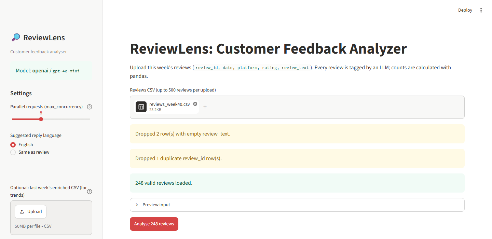
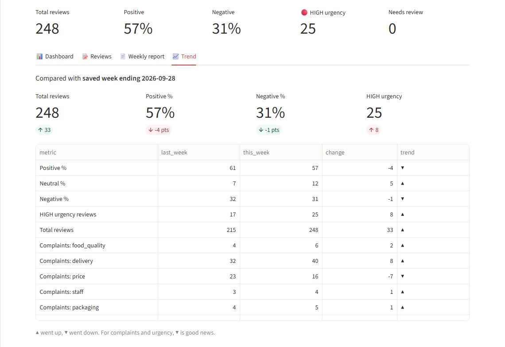

# 🔎 ReviewLens: Customer Feedback Analyzer

> **Track 1 Gen AI | LangChain — Use case 01 (Intermediate).** Turn hundreds of raw customer reviews into tagged, prioritised insights and a weekly report a manager can act on in five minutes.

🌐 **Live app:** https://www.kowsalyagroups.com/techstack/
📘 **Step-by-step build & deploy guide (PDF):** [docs/ReviewLens_Build_Guide.pdf](docs/ReviewLens_Build_Guide.pdf)
📥 **Sample data:** [reviews_week40.csv](https://github.com/prasanth-sundararajan/reviewlens/releases/download/v1.0/reviews_week40.csv)


---

## What problem does it solve?

A restaurant chain or online store gets **200–500 reviews every week** from Google, Zomato, Swiggy and Amazon — in **English, Tamil and Tanglish**. Today a manager reads them by hand:

- urgent complaints (food poisoning, wrong order, rude staff) are missed for days;
- nobody can say *with numbers* what customers complain about most.

## What does ReviewLens do?

You upload the week's reviews as a CSV. ReviewLens:

1. **Reads every review with an LLM** and tags it with a fixed structure:

   | Field | Values | Why it matters |
   |---|---|---|
   | `sentiment` | positive · neutral · negative | Customer mood at a glance |
   | `category` | food_quality · delivery · price · staff · packaging · app | Which department must fix it |
   | `urgency` | low · medium · **high** | High = reply today (health, refund, rude staff, wrong order) |
   | `language` | English · Tamil · Tanglish · Other | Mixed-language reviews are understood |
   | `summary` | one English sentence | Read 248 lines instead of 248 paragraphs |
   | `suggested_reply` | polite, ready-to-post | Support team reviews and posts it |

2. **Counts everything with pandas** — sentiment split, categories, urgency, platforms. Numbers are never guessed by the LLM, so the report always matches the table.
3. **Writes a weekly report** with a second chain: top complaints, top praise, the urgent count and **3 action items**.
4. **Shows a dashboard** with charts and a **HIGH-urgency filter**, and exports an **Excel-ready CSV** for the support team.
5. **Compares with last week** (trend arrows ▲▼), can **reply in the review's own language**, and **emails the report every Monday** automatically.

## Screens

| | |
|---|---|
| **Upload & validation** — empty/duplicate rows dropped before any LLM call<br> | **HIGH urgency filter** — the 25 reviews that need a reply today<br> |
| **Weekly report** — top complaints, praise, action items, *VS LAST WEEK*<br> | **Trend vs last week** — automatic, from the last saved week<br> |
| **Replies in the review's language** — Tamil → Tamil, Tanglish → Tanglish<br> | **Monday email** — saved report + enriched CSV attached<br> |

More: [start page](docs/screenshots/01_start_page.png) · [500-review limit message](docs/screenshots/08_review_limit.png). All screenshots are real output (OpenAI `gpt-4o-mini`, sample week 40 vs saved week 39).

## How it works

```
01 Upload CSV → 02 Validate → 03 Classify (LLM, batched) → 04 Aggregate (pandas)
             → 05 Weekly report (map → reduce) → 06 Dashboard + CSV export
             → (save week) → trend arrows next week + Monday email
```

- **Structured output:** `ChatPromptTemplate | llm.with_structured_output(ReviewAnalysis)` — a Pydantic model whose fields are `Literal` enums, so invalid values are rejected.
- **Retry → `needs_review`:** invalid outputs are re-validated and retried twice; anything still failing is flagged instead of crashing the run.
- **Batching:** `chain.batch(..., max_concurrency=8)` — 248 reviews in about one minute.
- **Map → reduce report:** per-review summaries are grouped by category (condensed in chunks if large), then one chain writes the insights.
- **Swap models without changing chains:** `LLM_PROVIDER=openai | gemini | anthropic | mock` in `.env`.

| Tech | Used for |
|---|---|
| LangChain (LCEL), Pydantic | Prompt pipelines and typed LLM output |
| OpenAI `gpt-4o-mini` (Gemini / Claude supported) | The LLM |
| Streamlit, pandas, Plotly | Web app, numbers, charts |
| Docker, Caddy | Packaging; HTTPS with automatic Let's Encrypt certificates |
| SMTP (Gmail App Password) | Monday report email |
| pytest | 15 offline tests |

## Quick start

```bash
git clone https://github.com/prasanth-sundararajan/reviewlens.git
cd reviewlens
python -m venv .venv && .venv\Scripts\activate      # macOS/Linux: source .venv/bin/activate
pip install -r requirements.txt
copy .env.example .env                              # macOS/Linux: cp; then add OPENAI_API_KEY
streamlit run app.py                                # http://localhost:8501
```

Upload `data/reviews_week40.csv` and click **Analyse**. No API key yet? Set `LLM_PROVIDER=mock` in `.env` to try the whole app offline.

### Docker

```bash
docker compose up -d --build          # app + Monday-email scheduler, http://localhost:8501
```

Production with HTTPS (Caddy + Let's Encrypt): point a DNS A record at the server, set `OPENAI_API_KEY`, `APP_DOMAIN` (e.g. `www.example.com`) and optionally `APP_PATH` (default `techstack`) in `.env`, then:

```bash
docker compose -f docker-compose.yml -f docker-compose.prod.yml up -d --build
```

The full walkthrough — project setup, every module, tests, Docker, GitHub, VPS deploy, DNS, HTTPS and Gmail — is in the **[build guide PDF](docs/ReviewLens_Build_Guide.pdf)**.

### Weekly email (optional)

Add to `.env`: `SMTP_HOST`, `SMTP_PORT`, `SMTP_USER`, `SMTP_PASSWORD` (a Google **App Password** for the *same* Gmail account), `REPORT_RECIPIENTS`. Then:

```bash
python -m reviewlens.emailer --dry-run   # what would be sent
python -m reviewlens.emailer --test      # send a [TEST] email now
```

In the app, click **Save as this week's official report** each week — it is emailed every Monday 09:00 IST and used for next week's trend arrows.

## Project structure

```
app.py                    Streamlit UI
reviewlens/
  schema.py               Pydantic models: ReviewAnalysis, WeeklyInsights
  llm.py                  Model factory (OpenAI / Gemini / Claude / mock), reads .env
  validate.py             Step 02: column checks, cleaning, 500-review limit
  classify.py             Step 03: structured-output chain, batching, retry, needs_review
  aggregate.py            Step 04: counts, percentages, top complaints/praise, trends
  report.py               Step 05: map-reduce report chain + renderer
  export.py               Step 06: Excel-friendly CSV
  history.py              Saved official weeks (trend arrows + email source)
  emailer.py              Weekly report email (SMTP)
  scheduler.py            Sends the email every Monday (own container)
data/                     Sample weeks 39 and 40 (English, Tamil, Tanglish)
docs/                     Build guide PDF + screenshots
scripts/                  Sample-data generator, PDF builder, screenshot capture
tests/                    Offline pytest suite
Dockerfile, docker-compose*.yml, Caddyfile
```

## Tests

```bash
pytest -q        # 15 tests, offline, no API key needed
```

Covers CSV validation and the 500 limit, a 200+ row run, retry → `needs_review`, report numbers == table, percentages summing to 100, Excel export with Tamil text, trends, the weekly email and the Monday schedule.

## Done checklist

- [x] Processes a 200+ row CSV without crashing or timing out (248 reviews ≈ 1 minute)
- [x] Every review has all 6 fields and every value is from the allowed list
- [x] Tamil and Tanglish reviews get a correct English summary
- [x] Report numbers exactly match the table (calculated in pandas)
- [x] HIGH urgency filter works; the enriched CSV opens correctly in Excel
- [x] API key loaded from `.env`, never hard-coded
- [x] Stretch: trend arrows · replies in the review's language · Monday email

## Security notes

- Secrets (`OPENAI_API_KEY`, `SMTP_PASSWORD`) live only in `.env` — git-ignored locally, `chmod 600` on the server.
- The public app spends on your OpenAI key: keep the per-upload limit (`MAX_REVIEWS`) and set a monthly budget in your OpenAI account.
- Use a dedicated Gmail account and an App Password for sending; it can be revoked any time.
