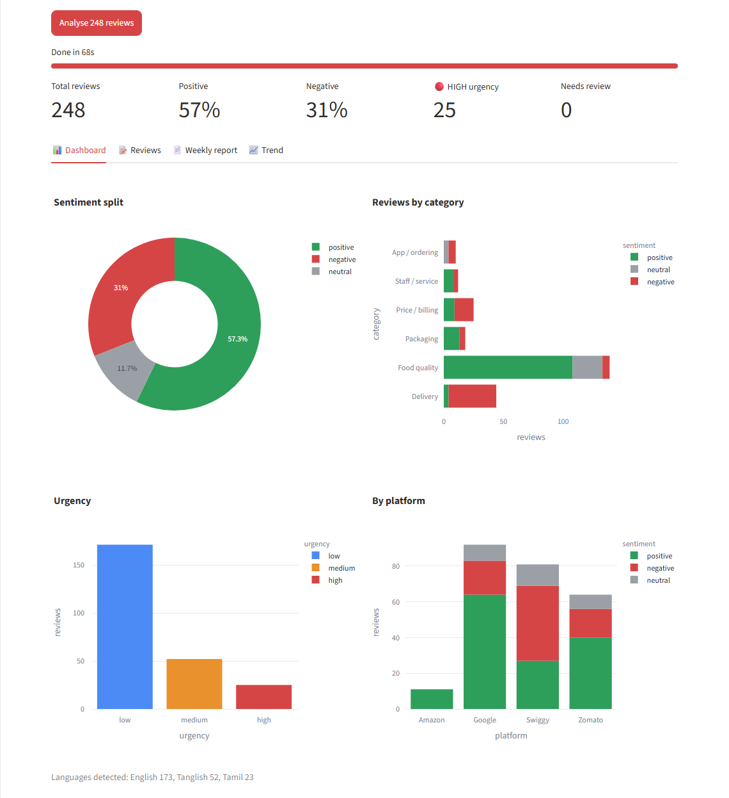
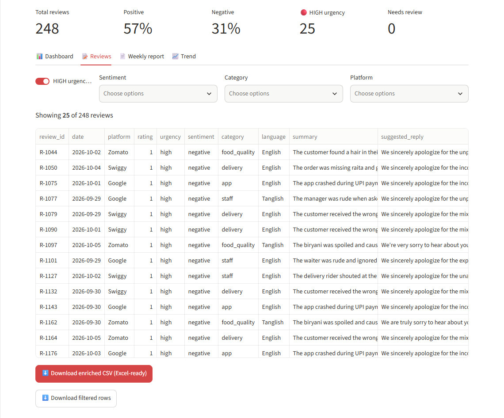
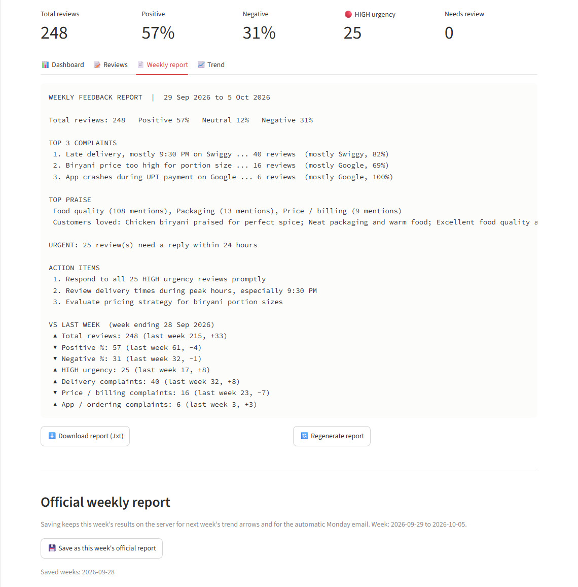
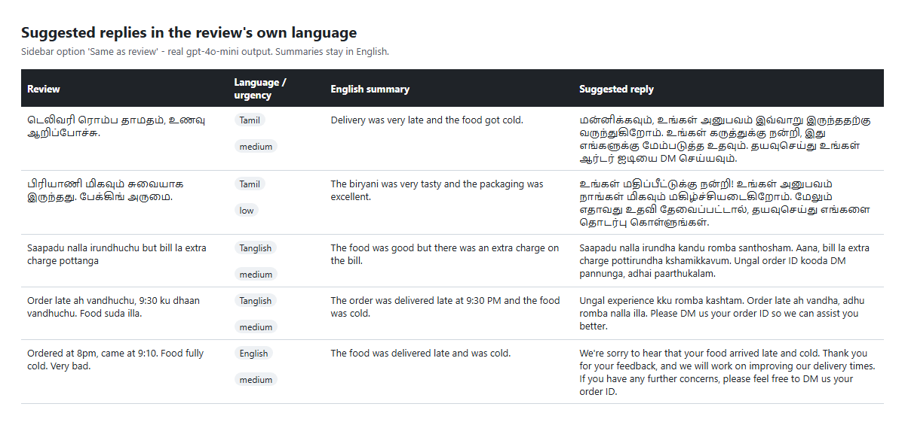
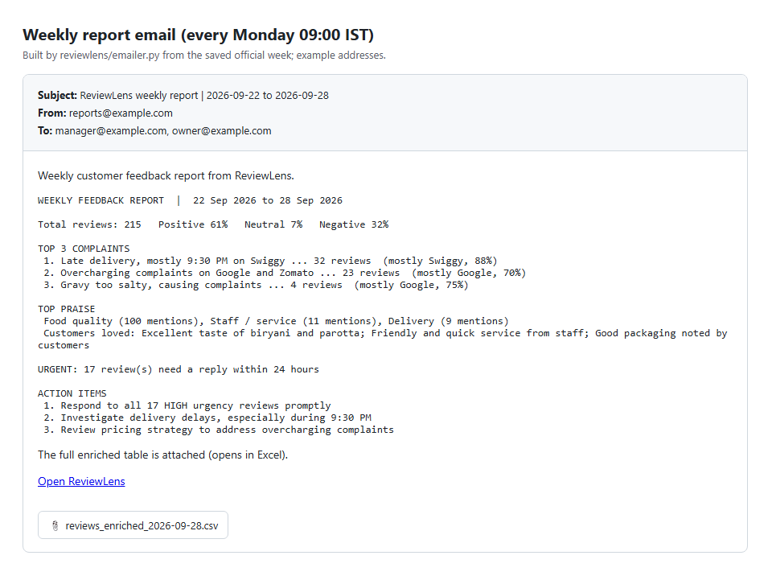

# 🔎 ReviewLens: Customer Feedback Analyzer

> **Track 1 Gen AI | LangChain — Use case 01 (Intermediate).** Turn hundreds of raw customer reviews into tagged, prioritised insights and a weekly report a manager can act on in five minutes.

🌐 **Live app:** https://www.kowsalyagroups.com/techstack/ReviewLens/
📘 **Step-by-step build & deploy guide (PDF):** [docs/ReviewLens_Build_Guide.pdf](docs/ReviewLens_Build_Guide.pdf)
📥 **Sample data:** [reviews_week40.csv](https://github.com/prasanth-sundararajan/reviewlens/releases/download/v1.0/reviews_week40.csv)



---

## What problem does it solve?

A restaurant chain or online store gets **200–500 reviews every week** from Google, Zomato, Swiggy and Amazon — in **English, Tamil and Tanglish**. Today a manager reads them by hand:

- urgent complaints (food poisoning, wrong order, rude staff) are missed for days;
- nobody can say *with numbers* what customers complain about most.

## What does ReviewLens do?

You upload the week's reviews as a CSV. ReviewLens:

1. **Reads every review with an LLM** and tags it with a fixed structure:

   | Field | Values | Why it matters |
   |---|---|---|
   | `sentiment` | positive · neutral · negative | Customer mood at a glance |
   | `category` | food_quality · delivery · price · staff · packaging · app | Which department must fix it |
   | `urgency` | low · medium · **high** | High = reply today (health, refund, rude staff, wrong order) |
   | `language` | English · Tamil · Tanglish · Other | Mixed-language reviews are understood |
   | `summary` | one English sentence | Read 248 lines instead of 248 paragraphs |
   | `suggested_reply` | polite, ready-to-post | Support team reviews and posts it |

2. **Counts everything with pandas** — sentiment split, categories, urgency, platforms. Numbers are never guessed by the LLM, so the report always matches the table.
3. **Writes a weekly report** with a second chain: top complaints, top praise, the urgent count and **3 action items**.
4. **Shows a dashboard** with charts and a **HIGH-urgency filter**, and exports an **Excel-ready CSV** for the support team.
5. **Compares with last week** (trend arrows ▲▼), can **reply in the review's own language**, and **emails the report every Monday** automatically.

## Screens

| | |
|---|---|
| **Upload & validation** — empty/duplicate rows dropped before any LLM call<br> | **HIGH urgency filter** — the 25 reviews that need a reply today<br> |
| **Weekly report** — top complaints, praise, action items, *VS LAST WEEK*<br> | **Trend vs last week** — automatic, from the last saved week<br> |
| **Replies in the review's language** — Tamil → Tamil, Tanglish → Tanglish<br> | **Monday email** — saved report + enriched CSV attached<br> |

More: [start page](docs/screenshots/01_start_page.png) · [500-review limit message](docs/screenshots/08_review_limit.png). All screenshots are real output (OpenAI `gpt-4o-mini`, sample week 40 vs saved week 39).

## How it works

```
01 Upload CSV → 02 Validate → 03 Classify (LLM, batched) → 04 Aggregate (pandas)
             → 05 Weekly report (map → reduce) → 06 Dashboard + CSV export
             → (save week) → trend arrows next week + Monday email
```

- **Structured output:** `ChatPromptTemplate | llm.with_structured_output(ReviewAnalysis)` — a Pydantic model whose fields are `Literal` enums, so invalid values are rejected.
- **Retry → `needs_review`:** invalid outputs are re-validated and retried twice; anything still failing is flagged instead of crashing the run.
- **Batching:** `chain.batch(..., max_concurrency=8)` — 248 reviews in about one minute.
- **Map → reduce report:** per-review summaries are grouped by category (condensed in chunks if large), then one chain writes the insights.
- **Swap models without changing chains:** `LLM_PROVIDER=openai | gemini | anthropic | mock` in `.env`.

| Tech | Used for |
|---|---|
| LangChain (LCEL), Pydantic | Prompt pipelines and typed LLM output |
| OpenAI `gpt-4o-mini` (Gemini / Claude supported) | The LLM |
| Streamlit, pandas, Plotly | Web app, numbers, charts |
| Docker, Caddy | Packaging; HTTPS with automatic Let's Encrypt certificates |
| SMTP (Gmail App Password) | Monday report email |
| pytest | 15 offline tests |

## Run on your laptop

You need **Python 3.11+**, **Git** and an **OpenAI API key** (for option B also **Docker Desktop**).

### Option A — Python (quickest)

```bash
git clone https://github.com/prasanth-sundararajan/reviewlens.git
cd reviewlens
python -m venv .venv
.venv\Scripts\activate                 # macOS/Linux: source .venv/bin/activate
pip install -r requirements.txt
copy .env.example .env                 # macOS/Linux: cp .env.example .env
```

Open `.env` and set `OPENAI_API_KEY=sk-...` (keep `LLM_PROVIDER=openai`), then:

```bash
streamlit run app.py                   # opens http://localhost:8501
```

Upload `data/reviews_week40.csv` (or use the *Download sample* button) and click **Analyse**.
No API key yet? Set `LLM_PROVIDER=mock` in `.env` to try the whole app offline (keyword-based results).

### Option B — Docker (same setup as the server)

```bash
copy .env.example .env                 # add OPENAI_API_KEY
docker compose up -d --build           # app + Monday-email scheduler → http://localhost:8501
docker compose ps                      # both services should be "Up"
docker compose logs -f reviewlens      # watch the app log (Ctrl+C to stop watching)
docker compose down                    # stop everything
```

### Check it works

```bash
pytest -q                              # 15 offline tests, no API key needed
```

## Deploy on Hostinger (VPS)

This is how the live app at `https://www.kowsalyagroups.com/techstack/ReviewLens/` is deployed (`APP_PATH=techstack/ReviewLens`; it shares the server with [LaunchScout](https://github.com/prasanth-sundararajan/launchscout) at `/techstack/launchscout/`, see [`sites.d/`](sites.d/README.md)). Hostinger **shared/web hosting cannot run Python apps** — use a **Hostinger VPS** (KVM plan, e.g. KVM 2) with Ubuntu.

> **Fastest: one command from your Windows laptop.** With a Hostinger API token (hPanel → Account → API), this takes a snapshot, adds your SSH key, points DNS at the VPS and installs everything — no hPanel clicks:
>
> ```powershell
> $env:HOSTINGER_API_TOKEN = "<your token>"
> .\scripts\hostinger_setup.ps1 -Domain yourdomain.com          # app at https://www.yourdomain.com/techstack/
> .\scripts\hostinger_setup.ps1 -Domain yourdomain.com -DryRun  # preview first, changes nothing
> ```
>
> Already on the VPS? `curl -fsSLo server_setup.sh https://raw.githubusercontent.com/prasanth-sundararajan/reviewlens/main/scripts/server_setup.sh && sudo bash server_setup.sh` does steps 4–6 below in one go. Every command is also listed in [All terminal commands](#all-terminal-commands-copy-paste).
>
> The manual steps:

**1. Get the VPS ready (hPanel)**
- In **hPanel → VPS**, choose your server with an **Ubuntu** template (plain Ubuntu 24.04+ works; you install Docker yourself in step 4). Note its **IP address**.
- *Recommended:* create a **snapshot** first (VPS → Snapshots & backups) so you can roll back.

**2. Create an SSH key on your laptop and add it in hPanel**

```powershell
ssh-keygen -t ed25519 -f $HOME\.ssh\reviewlens_vps      # press Enter for no passphrase
Get-Content $HOME\.ssh\reviewlens_vps.pub               # copy this line
```

In **hPanel → VPS → Settings → SSH keys**, add the copied public key. Test the login:

```powershell
ssh -i $HOME\.ssh\reviewlens_vps root@<VPS-IP>
```

**3. Point your domain at the VPS (hPanel → Domains → your domain → DNS / Nameservers)**
- Add an **A record**: name `www` → value `<VPS-IP>`, TTL 300.
- If `www` already exists as a **CNAME**, delete it first (a name cannot have both).
- Check: `nslookup www.yourdomain.com` should show `<VPS-IP>` (usually within minutes).

**4. Install Docker on the VPS** (in the SSH session)

```bash
apt-get update && apt-get install -y docker.io docker-compose-v2 git
systemctl enable --now docker
docker --version && docker compose version
```

**5. Get the code and create the server `.env`**

```bash
git clone https://github.com/prasanth-sundararajan/reviewlens.git /opt/reviewlens
cd /opt/reviewlens
cp .env.example .env
nano .env                  # fill in the values below, then Ctrl+O, Enter, Ctrl+X
chmod 600 .env             # only root can read the secrets
```

| Setting in `.env` | Example | Notes |
|---|---|---|
| `OPENAI_API_KEY` | `sk-...` | Required |
| `APP_DOMAIN` | `www.yourdomain.com` | Must match the DNS A record |
| `APP_PATH` | `techstack` | App is served at `https://www.yourdomain.com/techstack/` |
| `MAX_REVIEWS` | `500` | Cost guard per upload |
| `APP_PASSWORD` | *(empty)* | Set a value to require a login; leave empty for public access |
| `SMTP_HOST`, `SMTP_PORT`, `SMTP_USER`, `SMTP_PASSWORD`, `REPORT_RECIPIENTS` | `smtp.gmail.com`, `587`, … | Optional — Monday email (see below) |
| `APP_URL` | `https://www.yourdomain.com/techstack/` | Link inside the email |

**6. Start it with HTTPS**

```bash
docker compose -f docker-compose.yml -f docker-compose.prod.yml up -d --build
docker compose -f docker-compose.yml -f docker-compose.prod.yml ps        # caddy, reviewlens, scheduler = Up
docker compose -f docker-compose.yml -f docker-compose.prod.yml logs caddy | grep "certificate obtained"
```

Caddy gets a free **Let's Encrypt** certificate automatically (ports 80/443 must be free). Open `https://www.yourdomain.com/techstack/` — plain `http://` and `/` redirect there, and port 8501 is not exposed to the internet.

**7. (Optional) Test the weekly email**

```bash
docker compose -f docker-compose.yml -f docker-compose.prod.yml exec scheduler python -m reviewlens.emailer --test
docker compose -f docker-compose.yml -f docker-compose.prod.yml logs scheduler   # "next weekly email at ... Monday 09:00"
```

**8. Update after you push changes to GitHub** (from your laptop)

```powershell
ssh -i $HOME\.ssh\reviewlens_vps root@<VPS-IP> "cd /opt/reviewlens && git pull && docker compose -f docker-compose.yml -f docker-compose.prod.yml up -d --build"
```

The app and scheduler restart automatically after crashes and server reboots (`restart: unless-stopped`).

| Problem on Hostinger | Fix |
|---|---|
| Certificate not issued | DNS A record not pointing at the VPS yet, or ports 80/443 used by another service |
| Site shows Hostinger "Parked domain" page | `www` still a CNAME to the parked root — replace it with an A record |
| `Permission denied (publickey)` | Add the `.pub` key in hPanel → VPS → SSH keys; use `ssh -i <key>` |
| Email `535 Username and Password not accepted` | `SMTP_USER` must be the Gmail account that created the App Password |

## All terminal commands (copy-paste)

Everything above as commands only — no hPanel clicks. Replace `yourdomain.com`, `<VPS-ID>` and `<VPS-IP>`. Laptop commands are **PowerShell**; server commands run in the **SSH session**.

**A. Laptop: Hostinger API token and your VPS** (token: hPanel → Account → API)

```powershell
$env:HOSTINGER_API_TOKEN = "<your token>"
$H = @{ Authorization = "Bearer $env:HOSTINGER_API_TOKEN"; Accept = "application/json" }
$api = "https://developers.hostinger.com"
Invoke-RestMethod "$api/api/vps/v1/virtual-machines" -Headers $H | Select-Object id, hostname, state, @{n="ip";e={$_.ipv4[0].address}}
$VM = <VPS-ID>; $IP = "<VPS-IP>"; $DOMAIN = "yourdomain.com"
```

**B. Laptop: snapshot (backup) first** — replaces an older snapshot

```powershell
Invoke-RestMethod -Method Post "$api/api/vps/v1/virtual-machines/$VM/snapshot" -Headers $H
Invoke-RestMethod "$api/api/vps/v1/virtual-machines/$VM/snapshot" -Headers $H        # check it
```

**C. Laptop: SSH key — create, add to the VPS, test**

```powershell
ssh-keygen -t ed25519 -f $HOME\.ssh\reviewlens_vps        # press Enter twice (no passphrase)
$pub = (Get-Content $HOME\.ssh\reviewlens_vps.pub -Raw).Trim()
Invoke-RestMethod -Method Post "$api/api/vps/v1/virtual-machines/$VM/ssh-keys" -Headers $H -ContentType "application/json" -Body (@{ keys = @($pub) } | ConvertTo-Json)
ssh -i $HOME\.ssh\reviewlens_vps root@$IP "hostname; uptime"
```

**D. Laptop: DNS — `www` → VPS** (removes a `www` CNAME first, if there is one)

```powershell
Invoke-RestMethod "$api/api/dns/v1/zones/$DOMAIN" -Headers $H | Format-Table name, type, @{n="value";e={$_.records.content}}
Invoke-RestMethod -Method Delete "$api/api/dns/v1/zones/$DOMAIN" -Headers $H -ContentType "application/json" -Body (@{ filters = @(@{ name = "www"; type = "CNAME" }) } | ConvertTo-Json -Depth 5)
Invoke-RestMethod -Method Put "$api/api/dns/v1/zones/$DOMAIN" -Headers $H -ContentType "application/json" -Body (@{ overwrite = $true; zone = @(@{ name = "www"; type = "A"; ttl = 300; records = @(@{ content = $IP }) }) } | ConvertTo-Json -Depth 6)
Resolve-DnsName "www.$DOMAIN" -Type A -Server 8.8.8.8 -DnsOnly            # must show the VPS IP
```

**E. Server: install and start** — `ssh -i $HOME\.ssh\reviewlens_vps root@<VPS-IP>`, then either the script (asks for the OpenAI key, hidden):

```bash
curl -fsSLo server_setup.sh https://raw.githubusercontent.com/prasanth-sundararajan/reviewlens/main/scripts/server_setup.sh
sudo APP_DOMAIN=www.yourdomain.com bash server_setup.sh
```

…or by hand:

```bash
apt-get update && apt-get install -y docker.io docker-compose-v2 git
systemctl enable --now docker
git clone https://github.com/prasanth-sundararajan/reviewlens.git /opt/reviewlens && cd /opt/reviewlens
read -rsp "OpenAI API key: " KEY; echo
umask 077; cat > .env <<EOF
LLM_PROVIDER=openai
LLM_MODEL=gpt-4o-mini
OPENAI_API_KEY=$KEY
MAX_REVIEWS=500
APP_DOMAIN=www.yourdomain.com
APP_PATH=techstack
APP_PASSWORD=
APP_URL=https://www.yourdomain.com/techstack/
SMTP_HOST=smtp.gmail.com
SMTP_PORT=587
SMTP_USER=
SMTP_PASSWORD=
REPORT_RECIPIENTS=
EOF
unset KEY; chmod 600 .env
docker compose -f docker-compose.yml -f docker-compose.prod.yml up -d --build
```

**F. Check it is live** (laptop, PowerShell)

```powershell
$d = "www.yourdomain.com"
curl.exe -s -o NUL -w "health %{http_code}`n" "https://$d/techstack/_stcore/health"              # 200
curl.exe -s -o NUL -w "http   %{http_code} -> %{redirect_url}`n" "http://$d/techstack/"           # 308 -> https
curl.exe -s -o NUL -w "root   %{http_code} -> %{redirect_url}`n" "https://$d/"                    # 302 -> /techstack/
$t = New-Object Net.Sockets.TcpClient($d, 443); $s = New-Object Net.Security.SslStream($t.GetStream()); $s.AuthenticateAsClient($d); "certificate until " + $s.RemoteCertificate.GetExpirationDateString(); $t.Close()
```

**G. Server: day-to-day** (in `/opt/reviewlens`)

```bash
alias rl='docker compose -f docker-compose.yml -f docker-compose.prod.yml'
rl ps                                             # caddy, reviewlens, scheduler = Up
rl logs -f reviewlens                             # app log
rl logs scheduler | tail -3                       # next Monday email time
rl exec scheduler python -m reviewlens.emailer --test     # send a [TEST] email
sudo bash scripts/server_setup.sh                 # update to the latest GitHub version
nano .env && rl up -d --force-recreate            # change settings
rl down                                           # stop everything
```

**H. Laptop: roll back** (restores the snapshot from step B — the whole VPS goes back to that moment)

```powershell
Invoke-RestMethod -Method Post "$api/api/vps/v1/virtual-machines/$VM/snapshot/restore" -Headers $H
```

The full walkthrough — project setup, every module, tests, Docker, GitHub, Hostinger, DNS, HTTPS and Gmail — is in the **[build guide PDF](docs/ReviewLens_Build_Guide.pdf)**.

### Weekly email (optional)

Add to `.env`: `SMTP_HOST`, `SMTP_PORT`, `SMTP_USER`, `SMTP_PASSWORD` (a Google **App Password** for the *same* Gmail account), `REPORT_RECIPIENTS`. Then:

```bash
python -m reviewlens.emailer --dry-run   # what would be sent
python -m reviewlens.emailer --test      # send a [TEST] email now
```

In the app, click **Save as this week's official report** each week — it is emailed every Monday 09:00 IST and used for next week's trend arrows.

## Project structure

```
app.py                    Streamlit UI
reviewlens/
  schema.py               Pydantic models: ReviewAnalysis, WeeklyInsights
  llm.py                  Model factory (OpenAI / Gemini / Claude / mock), reads .env
  validate.py             Step 02: column checks, cleaning, 500-review limit
  classify.py             Step 03: structured-output chain, batching, retry, needs_review
  aggregate.py            Step 04: counts, percentages, top complaints/praise, trends
  report.py               Step 05: map-reduce report chain + renderer
  export.py               Step 06: Excel-friendly CSV
  history.py              Saved official weeks (trend arrows + email source)
  emailer.py              Weekly report email (SMTP)
  scheduler.py            Sends the email every Monday (own container)
data/                     Sample weeks 39 and 40 (English, Tamil, Tanglish)
docs/                     Build guide PDF + screenshots
scripts/                  Sample-data generator, PDF builder, screenshot capture
tests/                    Offline pytest suite
Dockerfile, docker-compose*.yml, Caddyfile
```

## Tests

```bash
pytest -q        # 15 tests, offline, no API key needed
```

Covers CSV validation and the 500 limit, a 200+ row run, retry → `needs_review`, report numbers == table, percentages summing to 100, Excel export with Tamil text, trends, the weekly email and the Monday schedule.

## Done checklist

- [x] Processes a 200+ row CSV without crashing or timing out (248 reviews ≈ 1 minute)
- [x] Every review has all 6 fields and every value is from the allowed list
- [x] Tamil and Tanglish reviews get a correct English summary
- [x] Report numbers exactly match the table (calculated in pandas)
- [x] HIGH urgency filter works; the enriched CSV opens correctly in Excel
- [x] API key loaded from `.env`, never hard-coded
- [x] Stretch: trend arrows · replies in the review's language · Monday email

## Security notes

- Secrets (`OPENAI_API_KEY`, `SMTP_PASSWORD`) live only in `.env` — git-ignored locally, `chmod 600` on the server.
- The public app spends on your OpenAI key: keep the per-upload limit (`MAX_REVIEWS`) and set a monthly budget in your OpenAI account.
- Use a dedicated Gmail account and an App Password for sending; it can be revoked any time.
